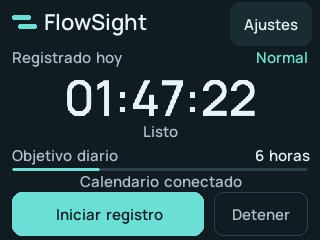

# FlowSight ESP32

A native touchscreen companion for [FlowSight AI](https://github.com/Mancasvel/FlowSight.AI). Firmware **0.2.0** works with **FlowSight 6.1.1 for Windows**, connected by the same USB-C cable used for power.



The image is a framebuffer capture rendered by the device from a documented test snapshot, not a photograph or a live account reading.

## What it does

- Mirrors the desktop app's exact clock, status, Normal/Pomodoro mode, daily goal and available calendar context.
- Starts, pauses, resumes and stops the same tracking session in the app. Stopping and mode changes have confirmation screens.
- Follows the app's English/Spanish language preference, including native settings and connection messages.
- Offers an End break action during a Pomodoro break.
- Freezes the last reading and disables controls after five seconds without app updates. Reconnects automatically.
- Stores local brightness and four-point touch calibration across normal firmware updates.

Open FlowSight and connect the ESP32. No Wi-Fi credentials, browser extension or separate bridge process are required. The app remains the timer authority; this firmware does not run a separate focus timer.

Tap Settings / Ajustes for Normal/Pomodoro mode, brightness and touch calibration. Short-press **BOOT** for the current primary action. Hold BOOT for **1.5 seconds after startup** to calibrate; touch and release each of four crosses. A short BOOT press cancels calibration. Do not hold BOOT while powering on unless entering the flashing bootloader.

## Hardware

This build targets the connected **CS-32 N4XX**, a single-USB-C ESP32-D0WD-V3 with 4 MB flash. Its working profile matches **ESP32-2432S024R** wiring: ILI9341_2-compatible LCD, GPIO27 backlight, XPT2046 resistive touch on the shared display SPI bus, and a corrected landscape orientation. Display orientation and calibrated physical touch were confirmed on this unit.

| Connection | GPIO |
|---|---|
| Shared LCD/touch SCLK / MOSI / MISO | 14 / 13 / 12 |
| LCD CS / DC / backlight | 15 / 2 / 27 |
| Touch CS / IRQ | 33 / 36 |
| BOOT | 0 |

Boards marketed as Cheap Yellow Display can have different wiring. This profile is not interchangeable with a GPIO21-backlight ESP32-2432S028R or every ST7789/capacitive variant. See `include/Display.h` before adapting another unit.

## 3D-printable enclosure

[**FlowSight Desk**](enclosure/README.md) is a branded desktop enclosure with a 65° stand, removable rear cover, ventilated service hatch and lateral USB access. Download the 3MF print layouts, individual STL parts, editable STEP models and [illustrated assembly guide](enclosure/FlowSight-Desk-guia.pdf).


Two mechanical configurations are included: a 024 reference for the CS-32 N4XX and a 2.8-inch ESP32-2432S028R enclosure. Print the corresponding fit template first: the CS-32's mechanical dimensions have not yet been confirmed, and the 028 enclosure does not change the firmware's supported wiring profile. The image is a render of the printable CAD with a firmware-generated test snapshot.

## Build and install

Quit FlowSight first so it releases the USB serial port. Install Python 3, then:

```powershell
python -m venv .venv
.\.venv\Scripts\python -m pip install -r requirements.txt
.\.venv\Scripts\python -m platformio run
.\.venv\Scripts\python -m platformio run --target upload --upload-port COM3
```

Use the port assigned to your board. Uploads use 230400 baud. Normal updates preserve calibration and brightness. PlatformIO stores toolchains in `.local/platformio` and build output in `.pio`. On Linux/macOS use `.venv/bin/python`; the desktop USB integration currently requires Windows.

For a blank board or replacement firmware, the release provides one merged image including the bootloader and partition table:

```powershell
python -m esptool --chip esp32 --port COM3 --baud 230400 write-flash 0x0 firmware/FlowSight-ESP32.bin
```

For an existing FlowSight installation, use the normal PlatformIO upload above or the application-only update image to keep calibration and brightness:

```powershell
python -m esptool --chip esp32 --port COM3 --baud 230400 write-flash 0x10000 firmware/FlowSight-ESP32-update.bin
```

Do not erase flash during routine updates. `SHA256SUMS.txt` covers both release images.

## Diagnostics and development

Quit FlowSight before using the diagnostic client; only one process can own the serial port.

```powershell
python tools/device.py --port COM3 status
python tools/device.py --port COM3 calibrate
python tools/device.py --port COM3 screen artifacts/device-screen.png
python tools/verify_device.py --port COM3
```

The verifier acts as a test host and exercises the real firmware with explicit fixtures. It does not start desktop tracking or prove physical touch alignment. The `tap` diagnostic invokes a button in firmware and is distinct from the physical sensor's `touch_count`.

See [USB protocol](docs/USB-PROTOCOL.md), [verification notes](docs/VERIFICATION.md), and [design](DESIGN.md). Manrope is bundled under the SIL Open Font License; regenerating `include/Fonts.h` with `tools/make_fonts.py` additionally requires Pillow. No network service is exposed by the firmware.
