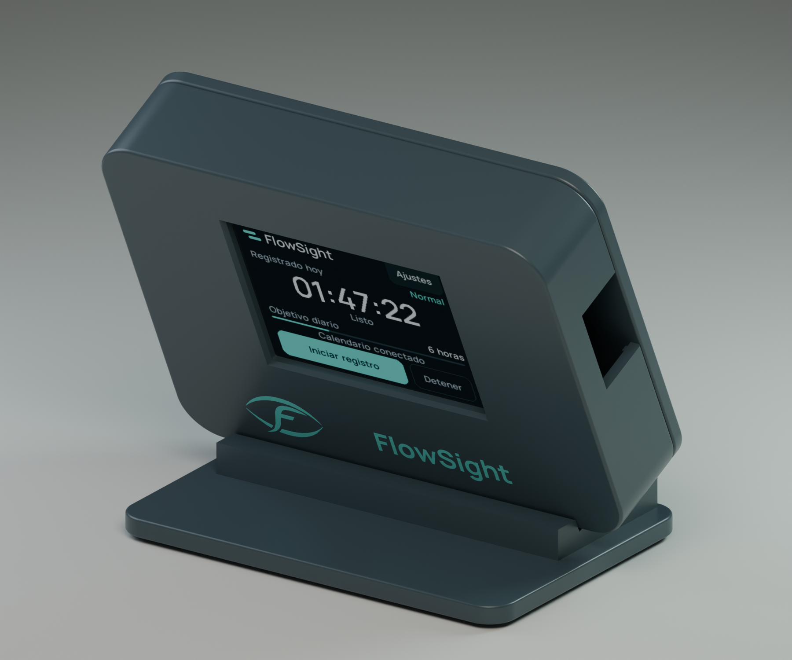

# FlowSight Desk — carcasa imprimible

Diseño CAD original de sobremesa para el acompañante USB de FlowSight. Cuerpo redondeado grafito, símbolo oficial de FlowSight y nombre grabados en el frontal, soporte a 65°, tapa trasera atornillada y registro de servicio ventilado.



[Guía ilustrada de impresión y montaje](FlowSight-Desk-guia.pdf) · [Vista trasera](preview/FlowSight-Desk-rear.png) · [Vista de piezas separadas](preview/FlowSight-Desk-exploded.png)

**Estado:** archivos listos para laminar e imprimir una primera unidad. La geometría digital está verificada. La CS-32 N4XX no se ha medido físicamente: su perfil eléctrico 024 no demuestra que comparta exactamente sus dimensiones. Imprime la plantilla de encaje antes de la carcasa o de fabricar un lote.

## Qué archivo utilizar

| Placa | Archivo preparado | Referencia mecánica |
|---|---|---|
| CS-32 N4XX, pendiente de comprobar | [3MF de referencia 024](print/FlowSight_Desk_CS32_024_reference.3mf) | PCB 74,4 × 42,9 mm; anclajes 68 × 36,5 mm; área visible 48,96 × 36,72 mm |
| ESP32-2432S028R de 2,8 pulgadas | [3MF para CYD 028](print/FlowSight_Desk_CYD_028.3mf) | PCB hasta 86,6 × 50 mm; anclajes 78 × 42 mm; área visible 57,6 × 43,2 mm |

Ambos 3MF incluyen un frontal, tapa trasera, registro de servicio y base. Las configuraciones tienen ventanas y anclajes distintos y comparten la tapa y la base. No mezcles los dos frontales. Las coordenadas de los STL ya corresponden a su orientación de impresión. Todos los archivos usan milímetros y escala 100 %.

Descarga los [STL individuales](print), el [conjunto STEP de referencia 024](FlowSight_Desk_CS32_024_reference.step) o el [conjunto STEP para CYD 028](FlowSight_Desk_CYD_028.step). En la página de cada archivo de GitHub, utiliza **Download raw file** para guardar el archivo original.

Dimensiones exteriores: 104 × 78 × 23,2 mm, o 25,2 mm en el registro posterior. Base: 90 × 64 mm. Ventana de pantalla: 50,2 × 38 mm para 024 y 58,8 × 44,4 mm para 028. Radio exterior: 9 mm. Pared nominal: 2,4 mm. La pantalla conserva todo el área activa y el bisel tiene una entrada inclinada de 0,8 mm.

## Primera prueba de encaje

1. Imprime `Fit_check_CS32_024_reference.stl` para la unidad actual. Si su pantalla es realmente de 2,8 pulgadas, utiliza `Fit_check_CYD_028.stl`. Consumen aproximadamente 5–6 g de PETG.
2. Comprueba las cuatro posiciones de tornillo y que la abertura muestra toda la zona activa. El patrón de agujeros decide el frontal; una coincidencia del conector o del firmware no basta.
3. Apoya únicamente el PCB en los cuatro postes. La pantalla y el digitalizador no deben recibir presión del marco. Hay separadores de 0,4, 0,8 y 1,2 mm si el conjunto necesita elevarse por la parte posterior. Añádelos uniformemente en los cuatro postes y revisa el espacio del cable.
4. Comprueba que el USB coincide con la abertura lateral, a la derecha mirando el frontal del render, de 20 mm de ancho y 13 mm de alto. El conector del cable debe atravesar la abertura; el cuerpo de la clavija puede entrar en el hueco lateral. Usa un cable de datos con funda de hasta 18 × 11 mm y comprueba su alcance. Si el USB de tu revisión está desplazado o en otro lado, modifica `usb_side` y `usb_y` en `source/parameters.json` y regenera el frontal. `left` en los parámetros significa X negativo del CAD, que se ve a la derecha desde el exterior del frontal.

Para convertir esta referencia en un encaje específico de la CS-32, mide el PCB, las distancias entre los centros de los cuatro agujeros, la zona activa, el desplazamiento de la pantalla respecto del PCB, la altura del PCB sobre la cara del vidrio y el centro del USB. Ajusta `screen_center` si la pantalla no está centrada. La plantilla y la carcasa no deben forzar la placa.

## Impresión

Configuración inicial recomendada: PETG mate grafito, boquilla de 0,4 mm, capa de 0,20 mm, cuatro perímetros, cinco capas superior/inferior y 20 % de relleno gyroid. Base al 25–30 %. Usa las temperaturas del fabricante del filamento. Las piezas están orientadas para imprimir sin soportes; inspecciona la vista por capas de tu laminador. Añade brim de 3–5 mm solo si tu impresora lo necesita.

El conjunto ocupa 214 × 148 mm en el 3MF: cabe en una cama de 220 × 220 mm, pero una zona de exclusión puede requerir separar piezas. No se entrega G-code porque depende de la impresora y del material. Tiempo orientativo: 6–10 horas según máquina. Consumo orientativo: 80–125 g; el laminador dará el cálculo concreto.

Frontal: cara exterior plana contra la cama, cavidad hacia arriba. Tapa y registro: caras exteriores contra la cama. Base: cara de los pies hacia la cama. No gires automáticamente las piezas a otra cara. Compensación inicial de pata de elefante: 0,15–0,20 mm; revisa la holgura de los labios.

La marca queda grabada a 0,6 mm. Para una impresora de un solo material, rellena el grabado con pintura turquesa y limpia la superficie. `Brand_inlay_optional.stl` es un inserto para impresión multimaterial: en el laminador debe añadirse como **parte del frontal**, no como otro objeto separado, manteniendo sus coordenadas relativas. Si se importa manualmente junto al frontal orientado para impresión, coloca el inserto en X=25,344787; Y=5,693811; Z=0 mm. Está formado por 14 cuerpos cerrados correspondientes a las letras y al símbolo. No recomiendo pegar cada fragmento de letra por separado.

## Tornillería y montaje

| Elemento | Cantidad | Tamaño |
|---|---:|---|
| Insertos térmicos de cierre | 4 | M3, diámetro exterior 4,6 mm, largo 5 mm; piloto 4,3 mm |
| Tornillos de tapa | 4 | M3 × 8 mm, cabeza cilíndrica ≤ 5,8 mm |
| Insertos para placa y registro | 6 | M2,5, diámetro exterior 3,5 mm, largo 3 mm; piloto 3,2 mm |
| Tornillos de placa | 4 | M2,5 × 4 mm, cabeza baja ≤ 4,8 mm |
| Tornillos de registro | 2 | M2,5 × 8 mm, cabeza baja ≤ 5 mm |
| Pies adhesivos | 4 | goma, diámetro 10 mm, espesor 1,5–2 mm |
| Cable | 1 | USB de datos correspondiente a la placa; USB-C en la CS-32 actual |

Instala los insertos con la placa fuera de la carcasa. Los cuatro M3 entran desde el interior hacia los postes del cierre; los cuatro M2,5 del PCB, desde la cara posterior de sus postes; los dos del registro, desde el interior de la tapa. Ajusta los pilotos si tus insertos tienen otras medidas. Los taladros M3 incluyen espacio de alivio para la punta del tornillo.

Coloca la placa en los postes y comprueba la pantalla, el touch y el cable antes de apretar. Aprieta a mano lo necesario para sujetar el PCB, evitando que flexione. Si utilizas separadores, aumenta la longitud del tornillo del PCB según ese espesor, dejando aproximadamente 2,4 mm dentro del inserto y evitando que alcance el fondo del poste. Cierra la tapa con los cuatro M3 y el registro con los dos M2,5. El registro se retira para acceder a BOOT/RESET y a los conectores de servicio. Coloca los pies y apoya la carcasa en la base; es una cuna desmontable por gravedad. El USB queda lateral para conservar el espacio posterior y no necesita una modificación electrónica.

La base se sujeta por peso y rozamiento; su comportamiento al pulsar la pantalla debe comprobarse en la primera unidad. Para vender unidades repetibles, fija el cable elegido, la referencia exacta de la placa, los insertos y el material tras esa prueba; confirma también presión de touch, estabilidad y temperatura de uso.

## Editar y reproducir

Los STEP de conjunto son `FlowSight_Desk_CS32_024_reference.step` y `FlowSight_Desk_CYD_028.step`. Se abren en FreeCAD, Fusion, SolidWorks, Onshape y herramientas compatibles con STEP. Los STEP de piezas están en `source`. El diseño paramétrico original es `source/build.py` con `source/parameters.json`.

```powershell
python -m venv .buildenv
.\.buildenv\Scripts\python -m pip install -r source/requirements.txt
.\.buildenv\Scripts\python source/build.py
& 'C:\Program Files\Blender Foundation\Blender 4.3\blender.exe' -b --python source/render.py
```

Las imágenes de `preview` son renders de las mallas imprimibles reales con materiales de presentación. La imagen de pantalla es una captura de framebuffer del firmware con datos de demostración; no es una foto ni una lectura de la cuenta del usuario.

Las [fuentes dimensionales y atribuciones](SOURCES.md) y los [resultados de verificación digital](geometry-verification.json) se incluyen junto al diseño. La tipografía Manrope mantiene su licencia OFL en [source/OFL.txt](source/OFL.txt). No se ha utilizado la carcasa del modelo comunitario como diseño base; se consultó únicamente el volumen de la placa para contrastar sus medidas.
